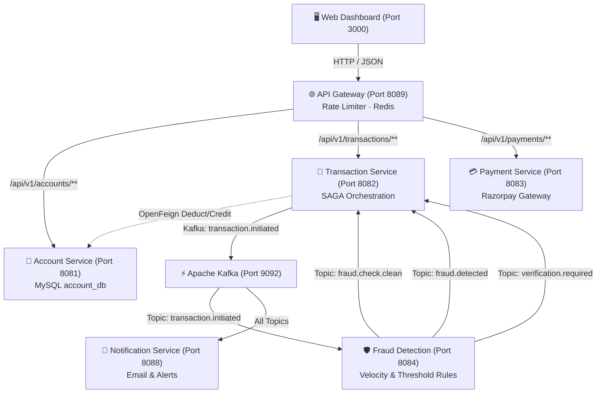

# NeoBank – Digital Banking Microservices System

A production-grade, event-driven Digital Banking System built with **Spring Boot 3**, **Apache Kafka**, **Redis**, **MySQL 8.0**, and **Spring Cloud Gateway**, featuring SAGA pattern distributed transactions, real-time fraud detection, and an interactive **Frontend Web Dashboard**.

---

## 🏗️ Architecture Overview



---

## 📦 Microservices & Ports

| Service | Port | Technology | Primary Responsibilities |
|---|---|---|---|
| **API Gateway** | `8089` | Spring Cloud Gateway, Redis | Single entrypoint, token-bucket rate limiting (10 req/s, 20 burst), CORS handler, route forwarding |
| **Account Service** | `8081` | Spring Boot 3, JPA, MySQL 8.0 | Account creation, balance enquiry, deposit/credit, withdrawal/deduct, account locking |
| **Transaction Service** | `8082` | Spring Boot 3, Feign, Kafka, Redis | SAGA fund transfers, OTP generation & verification (TTL 5 min in Redis), transaction history |
| **Payment Service** | `8083` | Spring Boot 3, Razorpay SDK, MySQL | Razorpay order creation, asynchronous payment webhook ingestion (`payment.captured`, `payment.failed`) |
| **Fraud Detection** | `8084` | Spring Boot 3, Kafka, Redis | Real-time event consumer: velocity limit (max 5 tx/min), amount anomaly (>5x avg), balance check (>90%) |
| **Notification Service** | `8088` | Spring Boot 3, Kafka, JavaMail | Kafka event consumer: dispatching debit/credit emails, OTP codes, fraud alerts, payment confirmations |
| **Frontend Dashboard** | `3000` | Vanilla HTML5, CSS3, JavaScript | Interactive web dashboard for demonstrating accounts, transactions, payments, and system health |

---

## ⚡ Quick Start (Run in 2 Minutes)

### 1. Prerequisites
- **Java 21** (`export JAVA_HOME=...`)
- **Docker & Docker Compose** (for MySQL, Redis, Kafka, Zookeeper)
- **Python 3** (for serving the frontend dashboard)

### 2. Start Everything (1 Command)
```bash
./start.sh
```
This automatically:
1. Starts the 4 Docker containers (MySQL, Redis, Kafka, Zookeeper).
2. Clears any stale port locks.
3. Launches all 6 Spring Boot microservices.
4. Starts the Frontend Dashboard on **[http://localhost:3000](http://localhost:3000)**.

### 3. Stop Everything Anytime
```bash
./stop.sh
```
*(Add `--all` to also shut down the Docker containers: `./stop.sh --all`)*

---

## 🖥️ Frontend Web Dashboard (`frontend/`)

Located in the `frontend/` directory, the UI provides an executive-ready interface designed with dark glassmorphic aesthetics:

- **Dashboard**: Live system stats, microservice health cards with pulsing green status indicators, and an interactive architecture diagram.
- **System Status**: Real-time status cards for all 6 microservices and infrastructure components.
- **Account Service**: Form to create savings/current accounts, search by account number, retrieve live balance, credit, deduct, or lock accounts.
- **Transaction Service**: Initiate SAGA fund transfers, view transaction statuses, inspect account history, and verify Redis OTPs.
- **Payment Service**: Create Razorpay payment orders and simulate incoming webhooks.
- **Fraud Detection & Notifications**: View active fraud detection rules, Kafka topics, and consumer event mappings.

---

## 📡 Service-Wise API Catalog

All endpoints are accessible through the **API Gateway** (`http://localhost:8089`):

### 1. Account Service (`:8081` via Gateway `:8089`)

#### Create Account
```bash
curl -X POST http://localhost:8089/api/v1/accounts \
  -H "Content-Type: application/json" \
  -d '{
    "accountHolderName": "Alice Johnson",
    "email": "alice@example.com",
    "phone": "+919876543210",
    "accountType": "SAVINGS",
    "initialDeposit": 10000.00
  }'
```

#### Get Account Details
```bash
curl http://localhost:8089/api/v1/accounts/{accountNumber}
```

#### Check Live Balance
```bash
curl http://localhost:8089/api/v1/accounts/{accountNumber}/balance
```

#### Credit Account
```bash
curl -X PUT "http://localhost:8089/api/v1/accounts/{accountNumber}/credit?amount=1500.00"
```

#### Deduct Account
```bash
curl -X PUT "http://localhost:8089/api/v1/accounts/{accountNumber}/deduct?amount=500.00"
```

#### Block Account
```bash
curl -X PUT http://localhost:8089/api/v1/accounts/{accountNumber}/block
```

---

### 2. Transaction Service (`:8082` via Gateway `:8089`)

#### Initiate Fund Transfer (SAGA Flow)
```bash
curl -X POST http://localhost:8089/api/v1/transactions/transfer \
  -H "Content-Type: application/json" \
  -d '{
    "senderAccountNumber": "362882121624",
    "receiverAccountNumber": "155624511658",
    "amount": 2500.00,
    "description": "Monthly rent payment"
  }'
```

#### Get Transaction by ID
```bash
curl http://localhost:8089/api/v1/transactions/{transactionId}
```

#### Get Account Transaction History
```bash
curl http://localhost:8089/api/v1/transactions/account/{accountNumber}
```

#### Verify OTP
```bash
curl -X POST "http://localhost:8089/api/v1/transactions/{transactionId}/verify?otp=123456"
```

---

### 3. Payment Service (`:8083` via Gateway `:8089`)

#### Create Razorpay Payment Order
```bash
curl -X POST http://localhost:8089/api/v1/payments/create-order \
  -H "Content-Type: application/json" \
  -d '{
    "accountNumber": "362882121624",
    "amount": 5000.00,
    "description": "Wallet top-up"
  }'
```

#### Simulate Razorpay Webhook
```bash
curl -X POST http://localhost:8089/api/v1/payments/webhook \
  -H "Content-Type: application/json" \
  -d '{
    "event": "payment.captured",
    "payload": {
      "payment": {
        "entity": {
          "id": "pay_test_998877",
          "order_id": "order_test_112233"
        }
      }
    }
  }'
```

---

### 4. Health Check Endpoints (Direct & Gateway-Proxied)

| Component | Gateway Proxied URL | Direct Actuator URL |
|---|---|---|
| **Account Service** | `http://localhost:8089/health/account` | `http://localhost:8081/actuator/health` |
| **Transaction Service** | `http://localhost:8089/health/transaction` | `http://localhost:8082/actuator/health` |
| **Payment Service** | `http://localhost:8089/health/payment` | `http://localhost:8083/actuator/health` |
| **Fraud Detection** | `http://localhost:8089/health/fraud` | `http://localhost:8084/actuator/health` |
| **Notification Service** | `http://localhost:8089/health/notification` | `http://localhost:8088/actuator/health` |
| **API Gateway** | `http://localhost:8089/actuator/health` | `http://localhost:8089/actuator/health` |

---

## 🔄 SAGA Pattern & Distributed Lifecycle

```
[Client] 
   │
   ▼ POST /api/v1/transactions/transfer
[Transaction Service] (Status: PROCESSING)
   │
   ├─► Feign Call: Account Service -> Deduct Sender
   │
   ├─► Kafka: transaction.initiated
   │      │
   │      ▼
   │   [Fraud Detection Service]
   │      ├─ Velocity Check (Redis: max 5/min)
   │      ├─ Anomaly Check (>5x avg)
   │      └─ Balance Check (>90%)
   │
   ├── If CLEAN:
   │      ├─ Feign Call: Account Service -> Credit Receiver
   │      ├─ Kafka: transaction.completed
   │      └─ Status: COMPLETED
   │
   ├── If SUSPICIOUS:
   │      ├─ Redis: Store OTP (TTL 300s)
   │      ├─ Kafka: verification.required / transaction.otp.generated
   │      └─ Status: PENDING_VERIFICATION
   │
   └── If FRAUD / REJECTED:
          ├─ Feign Call: Account Service -> Credit Sender (SAGA Compensation / Refund)
          ├─ Kafka: fraud.detected / transaction.refunded
          └─ Status: FLAGGED
```

---

## 🛡️ Rate Limiting & Security

The **API Gateway** (`:8089`) enforces token-bucket rate limiting via Redis:
- `/api/v1/accounts/**`: **10 req/s**, burst capacity: **20**
- `/api/v1/transactions/**`: **10 req/s**, burst capacity: **20**
- `/api/v1/payments/**`: **5 req/s**, burst capacity: **10**

Response headers returned with every API call:
- `X-RateLimit-Remaining`: Remaining request tokens
- `X-RateLimit-Burst-Capacity`: Maximum burst tokens
- `X-RateLimit-Replenish-Rate`: Token refresh rate per second
